<!-- _class: lead -->
<!-- _paginate: false -->

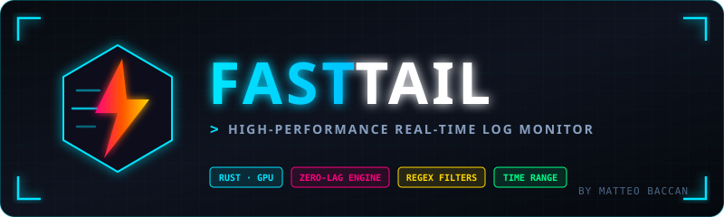

# FastTail

Ultra-fast multi-stream log monitor and tail viewer
Windows · Linux · macOS — in a window or in the terminal

github.com/matteobaccan/FastTail · matteobaccan.github.io/FastTail · MIT licence

---

## Why it was born

- **BareTail**, the reference tail viewer on Windows, has not changed since **2006**
  - Windows only, include / exclude filters only in the paid Pro version
  - nothing for JSON logs, compressed files, containers or remote servers
- Logs have changed since then:
  - files of **tens of gigabytes**, rotated and compressed
  - **structured** lines (JSON, logfmt) instead of free text
  - logs live in **containers, pods, journald, SSH servers**, the Windows Event Log
- The alternatives each cover a part: `tail -f | grep` (no overview),
  Tailviewer (.NET, Windows, dormant), lnav (terminal only), Seq / ELK (a server to run)

**Goal:** one native binary, instant on huge files, that takes you from
"something is wrong" to the line that explains it.

---

## What it is

- A **log viewer and monitor** written in **Rust**
- **Two interfaces**, one engine:
  - a GPU window (egui, wgpu with OpenGL fallback)
  - a full terminal interface, `fasttail-tui`, for SSH and servers
- **One binary**, no runtime, no server, no account
- Runs on **Windows x86_64, Linux x86_64 / ARM64, macOS**
- **16 interface languages**, 5 themes
- Free and open source, **MIT**

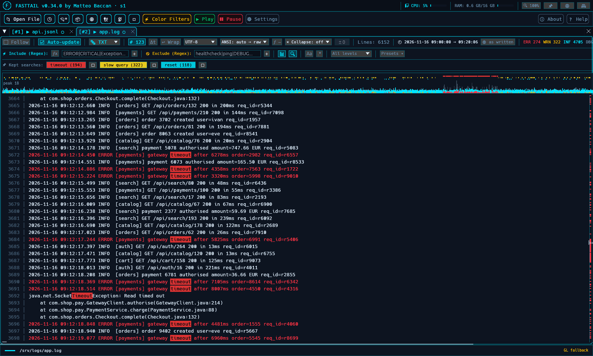

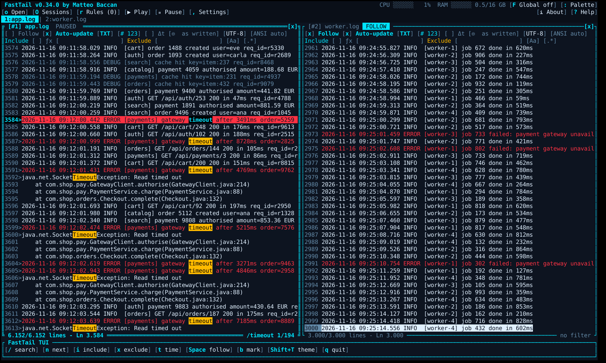

---

## The engine: fast on any size

- The file is **never loaded into memory**
  - rows read on demand through a **4 MB block cache** per stream
  - a line index of **8 bytes per line**, plus a level byte and a timestamp once scanned
- **Files over 50 GB open instantly**; filters and searches run in the background with progress
- **~60 MB of RAM** to follow ten 50 MB logs that keep growing
- Appends indexed as they arrive; **rotation, truncation and rewrites** detected
  without locking the writer
- No `mmap` by design: safe on files that shrink or are replaced under it

---

<!-- _class: split -->

## Finding the problem

- **Timeline histogram** of every stream, errors in red; click to jump
- **Kept searches**: up to 8 at once, each with its colour, count and **lane on the timeline**
- Regex and **multi-line** search, results pane, **search all streams**
- **Highlight rules** with colours, sounds and desktop notifications
- Bookmarks with notes, hide lines, collapse repeated lines, context lines

---

<!-- _class: split -->

## Structured logs

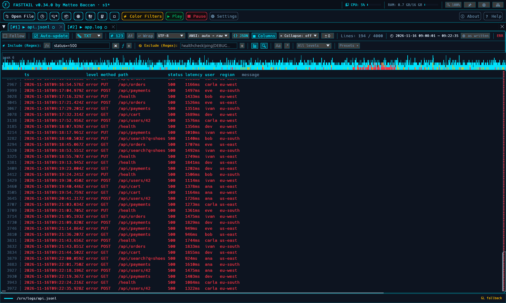

- JSON, logfmt, Apache, syslog, **CSV / TSV**, your own **named formats**
- **Column view**: pick, move, pin columns
- **Field filters**: `status>=500`, `level=error|fatal`, `user~=bot`
- **Values with units**: `latency>=1.5s` also matches `1700ms`
- **Filter expressions**: `(payment OR refund) AND timeout NOT retry`
- A **global filter** over every stream, saved **presets**

---

<!-- _class: split -->

## From lines to numbers

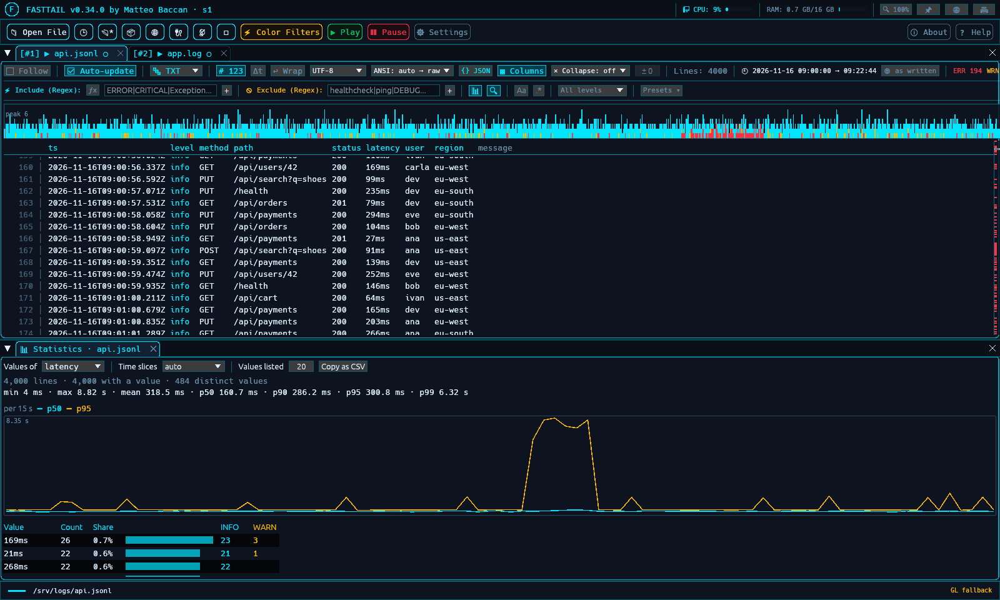

- **Field statistics**: top values, per-level counts, `p50 · p90 · p95 · p99`, a chart over time
- **Query** pipeline:
  `where status>=500 | stats count(), p95(latency) by path | sort -count`
- **Patterns**: thousands of lines grouped into templates (Drain)
- **Explain a spike**: what changed in a time span
- **Operations**: one Gantt bar per request id

---

<!-- _class: split -->

## Many logs, one timeline

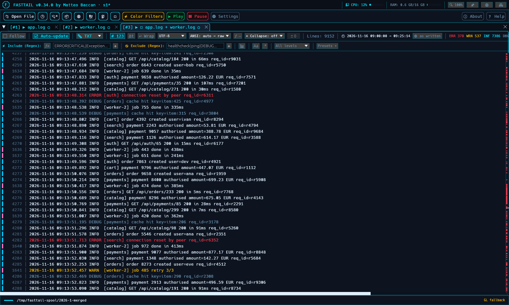

- **Merged view**: several streams interleaved by timestamp, still followed
- Time-range filter (`--since -15m`), go to a time, Δt column, UTC / local
- Lines out of order marked and walked
- **Rotated files as one stream** (`app.log`, `app.log.1`, `app.log.2.gz`)
- Split a big file; export as text, CSV or HTML

---

## Any source

| Files | Remote and systems | Windows | Other |
|---|---|---|---|
| any size and encoding | **SSH** `ssh://ops@web1/...` | **Event Log** channels | standard input |
| folders and patterns | **Docker / Podman** | `.evtx` files | the clipboard |
| `.gz` `.bz2` `.xz` `.zst` | **Kubernetes** pods `k8s://` | remote Event Log | AUTOSAR **DLT** traces |
| `.zip` `.7z` `.tar` entries | **journald** | debug output (DebugView) | source plugins |
| rotated sets | TCP / UDP / **syslog**, **OTLP** | | |

Every source is a stream with the same filters, search, rules and views.

---

## The terminal interface

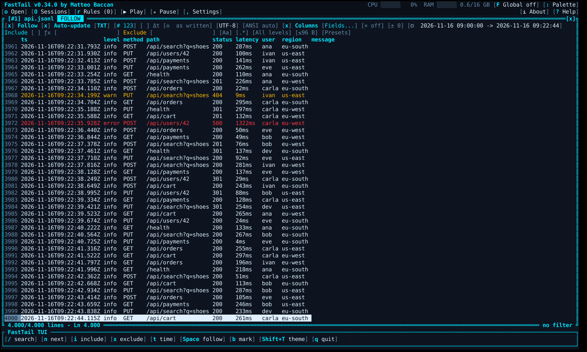

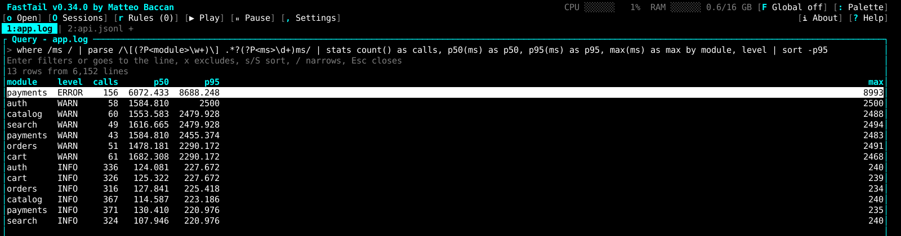

- `fasttail-tui` (or `fasttail --tui`): the **same engine** over SSH, in containers, on servers
- Windows, menus, **mouse**, splits, filters and rules, bookmarks
- Column view, merged views, **Statistics / Query / Patterns**
- Command palette `:`, **remappable keys**, 5 themes
- Works in any terminal, the Windows console included (`--ascii` for old ones)

---

## From the log to the work

- **Editor links**: `Main.java:42` in a stack trace opens VS Code, JetBrains, Sublime... at that line
- **Logging statement**: from a message to the line of code that printed it
- **Copy as excerpt**: lines with file, line numbers and time span for Jira, Slack, Markdown
- **MCP server**: Claude and other AI assistants read what FastTail shows
- **Web view**: a read-only page in the browser, local and behind a token
- **Print mode** for scripts: `fasttail --print --since -15m --level error --output json app.json | jq`
- External tools, plugins, sessions, PIN lock, tray icon

---

## How it compares

| | **FastTail** | BareTail | Tailviewer | `tail -f` / CLI |
|---|---|---|---|---|
| Platforms | **Windows, Linux, macOS** | Windows | Windows | Linux / macOS |
| Files > 50 GB | **Instant** | Good | Slow, high RAM | Fast |
| Window + terminal | **Both** | Window | Window | Terminal |
| Include / exclude filters | **Live, regex, expressions** | Pro only | Yes | `grep` |
| Structured logs, columns | **Yes** | No | No | `jq` |
| Statistics, query, patterns | **Yes** | No | No | `awk`, `sort \| uniq -c` |
| Merged timeline | **Yes** | No | Yes | No |
| Compressed logs | **gz, bz2, xz, zst, zip, 7z, tar** | No | No | `zcat` |
| SSH, Docker, Kubernetes, Event Log | **Yes** | No | No | separate tools |
| Runtime | **None (one binary)** | None | .NET | coreutils |
| Licence | **MIT** | Proprietary | MIT | open source |

Full table in the README; a wider look (klogg, lnav, LogExpert, Seq...) in docs/competitor-analysis.md.

---

## Benefits

**Developers**
- from a stack trace to the code in one click
- JSON logs readable as a table
- no setup: drop a file on the window

**Operations / SRE**
- the same tool on the desktop and over SSH
- containers, pods, journald, syslog in one place
- a spike explained in minutes, not with ad-hoc `awk`

**Support**
- open the customer's log bundle (zip, 7z, tar.gz) straight from the archive
- copy the relevant lines straight into the ticket

**Everyone**
- free, open source, **no server, no data leaves the machine**
- small footprint: a few tens of MB of RAM, the terminal interface on small VMs
- one tool instead of `tail`, `grep`, `jq`, `zcat`, a log viewer and a hex editor

---

## Five themes, both interfaces

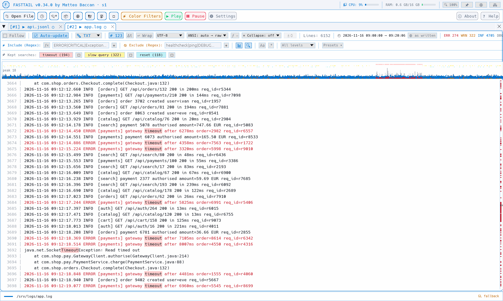

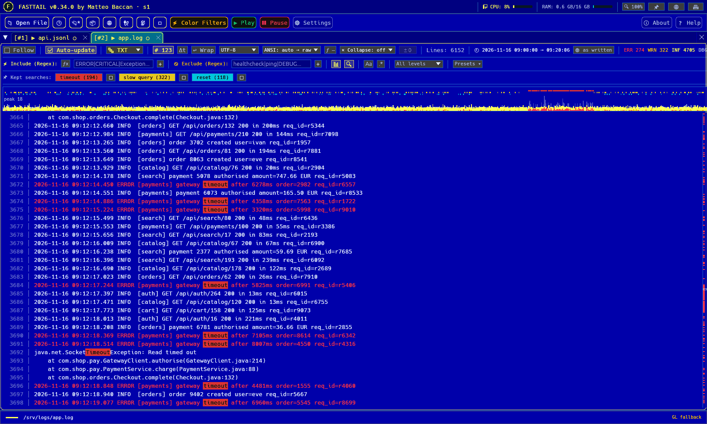

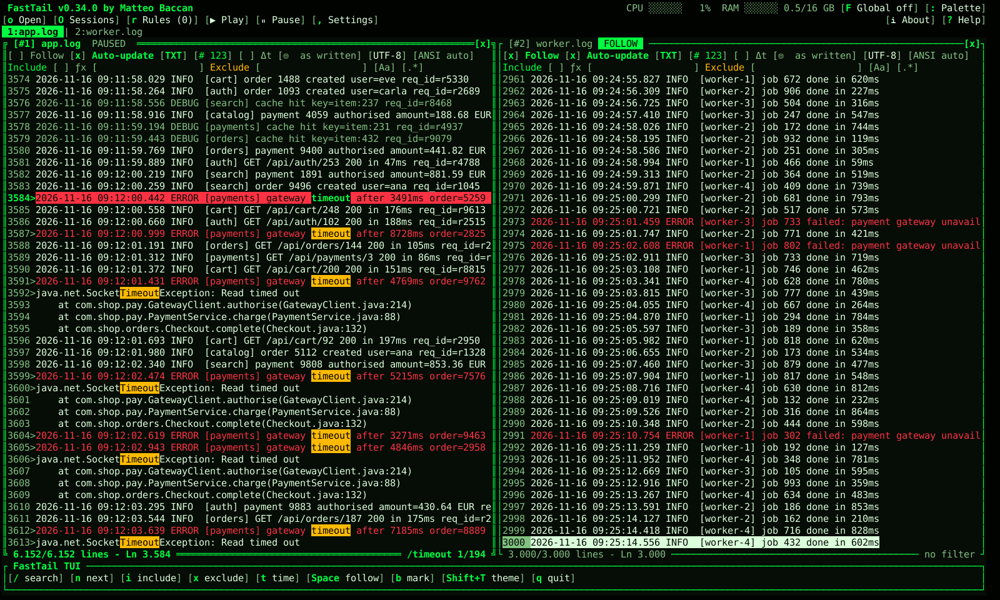

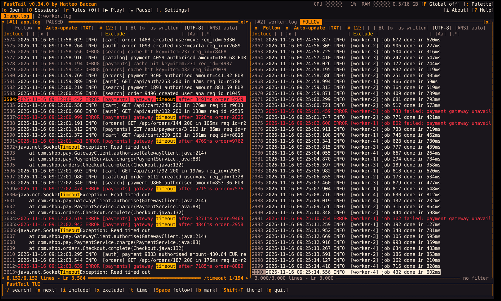

Tron · Matrix · Blade · Light · Commander

---

## How it is built

- **Spec first**: every behaviour is an [OpenSpec](https://github.com/Fission-AI/OpenSpec) specification in `openspec/specs`
- Implemented by **AI coding agents**, reviewed and tested by the maintainer
- CI on **Linux and Windows**: `clippy -D warnings`, `fmt`, a large integration suite
- Release builds for 4 targets: `.msi`, `.deb`, `.rpm`, AppImage, universal `.dmg`, archives
- Weekly patch releases; dependencies kept current through Renovate
- Contributions: **send specs, not code** (an issue describing the behaviour)

---

<!-- _class: lead -->
<!-- _paginate: false -->

# Try it

**github.com/matteobaccan/FastTail/releases/latest**

`fasttail app.log` · `fasttail-tui ssh://ops@web1/var/log/app.log`

matteobaccan.github.io/FastTail

Questions?
